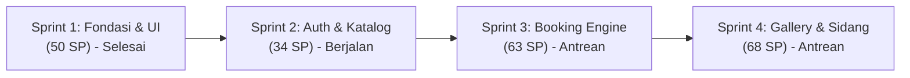

# MASTER SPRINT PLANNING & AUDIT SCRUM FRAMEWORK
## Sistem Informasi Pemesanan Jasa Fotografi & Manajemen Private Gallery Web
### Objek Studi: Iluxy Creative Padang

* **Pengembang / Mahasiswa**: Zackri Kurnia Amri (NIM: 2411082023)  
* **Program Studi**: D4 Teknologi Rekayasa Perangkat Lunak (TRPL), Jurusan TI, Politeknik Negeri Padang  
* **Dosen Pengampu**: Dwiny Meidelfi, S.KOM., M.CS. & Nurraudya Tuz Zahra, S.SI., M.C.S.(AI)  
* **Tumpukan Teknologi**: Next.js 16 (App Router, Turbopack, JSX) + React 19 + Supabase (PostgreSQL 12 Tabel 3NF, Auth, Storage, RLS) + Tailwind CSS v4 + Framer Motion  
* **Timeline Eksekusi**: **15 Hari Kalender / 14 Hari Kerja Efektif (13 November 2026 – 27 November 2026)**  
* **Lokasi Source Code**: Folder `web/`

---

## 1. PARAMETER PENGELOLAAN PROYEK & DEFINISI SCRUM

### 1.1 Definisi Estimasi & Kapasitas Tim
* **1 Story Point (SP)** $\approx$ **1 Jam Kerja Rekayasa Efektif** (mencakup koding, testing lokal, dan dokumentasi).
* **Total Beban Kerja**: **215 Story Points** (terbagi ke 20 Product Backlog Items dalam 4 Sprint Utama).
* **Posisi Hari Ini (H-8 / 20 November 2026)**:
  * Progres Aktual Selesai: **71 SP (PBI-01 s/d PBI-07 / 33% Progres Total)**.
  * Sisa Beban Kerja: **144 SP** dalam 6–7 hari kerja menuju deadline 27 November 2026.
  * Velocity Rata-rata Aktual: **$\approx 9 - 10$ SP / hari**.

### 1.2 Global Definition of Done (DoD)
Suatu Product Backlog Item (PBI) hanya boleh berstatus 🟢 **SELESAI** jika memenuhi 6 kriteria mutlak:
1. **Source Code**: Kode bersih (*lint free* via `npm run lint`), modular, dan mengikuti arsitektur Next.js 16 App Router.
2. **Build Clean**: Lolos pengujian kompilasi produksi tanpa error (`npm run build` sukses).
3. **Database & RLS**: Tabel memiliki foreign key 3NF, schema terverifikasi, dan hak akses RLS Supabase aktif.
4. **Keamanan (Shift-Left Security)**: Kebal dari SQL Injection, sanitasi input XSS, server-side payload validation, dan proteksi IDOR.
5. **Responsif & UI**: Tampilan konsisten pada resolusi Desktop ($\ge 1024px$) dan Mobile ($\le 768px$) dengan Dark Luxury theme.
6. **Git Convention**: Commit rapi menggunakan format standar konvensi (`feat`, `fix`, `docs`, `chore`, dsb.).

### 1.3 Klasifikasi Prioritas Fitur (MoSCoW)
* **Must Have (Wajib Ada untuk Syarat Sidang)**:
  * Autentikasi Multi-Role, Katalog Layanan, Booking Sesi Anti-Double Booking, Invoicing DP, Upload Bukti Bayar, Verifikasi Admin, Private Gallery PIN 6-Digit, dan Kurasi Foto Cetak Album.
* **Should Have (Sangat Penting untuk Operasional)**:
  * Filter & Live Search Katalog, Multi-Step Wizard Booking, Watermark Otomatis Foto Studio, dan Gated Master ZIP Download.
* **Could Have (Fitur Pelengkap / Estetika)**:
  * Micro-animations kursor spotlight, preset akun demo instan, dan dashboard analitik omzet Recharts.
* **Won't Have (Ditunda ke Fase Pengembangan v2.0)**:
  * Integrasi Payment Gateway Otomatis (Midtrans/Xendit) — transaksi tetap via Transfer Bank Manual + Upload Bukti Bayar.
  * Integrasi WhatsApp Gateway API berbayar — dialihkan menggunakan URL Direct WhatsApp `https://wa.me/...`.

---

## 2. STRUKTUR 4 SPRINT UTAMA (SCRUM RE-PLANNING)

Untuk menghindari fragmentasi kerja, 20 micro-sprint kini direstrukturisasi menjadi **4 Sprint Utama Scrum**:



| Sprint | Nama Sprint & Fokus Utama | Rentang Waktu | Target SP | Status | Sprint Goal |
|:---:|:---|:---:|:---:|:---:|:---|
| **Sprint 1** | **Fondasi, Design Tokens & Navigasi** | 13 - 15 Nov (H-1 s/d H-3) | 50 SP | 🟢 **SELESAI** | Menyiapkan fondasi Next.js 16, skema 12 tabel Supabase, design system, dan navigasi responsif. |
| **Sprint 2** | **Autentikasi Multi-Role & Katalog Publik** | 16 - 20 Nov (H-4 s/d H-8) | 34 SP | 🟢 **SELESAI (100%)** | Mengamankan autentikasi Klien vs Admin, proteksi rute middleware, dan mempublikasikan katalog layanan. |
| **Sprint 3** | **Booking Engine & Invoicing Finansial** | 21 - 24 Nov (H-9 s/d H-12) | 63 SP | 🟢 **SELESAI (100%)** | Membangun kalender anti-bentrok slot sesi, booking wizard, penerbitan invoice digital, dan verifikasi bayar. |
| **Sprint 4** | **Private Gallery, Proofing & Kesiapan Sidang** | 25 - 27 Nov (H-13 s/d H-15) | 68 SP | 🎯 **SIAP DIGAS** | Menyediakan gerbang galeri PIN 6 digit, kurasi album, gated master ZIP, serta audit pentest final sidang. |
| **TOTAL** | **4 Sprints (20 Product Backlog Items)** | **15 Hari** | **215 SP** | **147 / 215 SP (68%)** | **Sprint 1, 2, & 3 Tuntas (14 PBI Selesai). Siap Masuk ke Sprint 4 Final.** |

---

## 3. DASHBOARD PRODUCT BACKLOG ITEMS (PBI-01 s/d PBI-20)

| ID | Sprint | Modul & Fitur | Prioritas | SP | Status | Rekomendasi Pesan Komentar Commit |
|:---:|:---:|:---|:---:|:---:|:---:|:---|
| **PBI-01** | Sprint 1 | Setup Next.js 16, Tailwind v4 & Supabase SDK | Must | 8 SP | 🟢 Selesai | `chore: inisialisasi nextjs 14, tailwindcss dan supabase sdk` |
| **PBI-02** | Sprint 1 | DDL 12 Tabel Relasional 3NF, RLS & Storage | Must | 13 SP | 🟢 Selesai | `feat: implementasi ddl 11 tabel relasional 3nf, rls dan storage bucket` |
| **PBI-03** | Sprint 1 | Design Tokens, Button Anim, 3D Card & Shimmer | Could | 13 SP | 🟢 Selesai | `feat: implementasi design system dark luxury dan komponen micro interactions` |
| **PBI-04** | Sprint 1 | Desktop Floating Pill Navbar (Scroll & Hover) | Could | 8 SP | 🟢 Selesai | `feat: implementasi desktop floating pill navbar dengan dynamic scroll dan hover animation` |
| **PBI-05** | Sprint 1 | Mobile Bottom Tab Bar, Liquid Blob & FAB | Should | 8 SP | 🟢 Selesai | `feat: implementasi mobile bottom tab bar dengan liquid spring blob dan fab` |
| **PBI-06** | Sprint 2 | Multi-Role Auth, Login, Register & Middleware | Must | 13 SP | 🟢 Selesai | `feat: implementasi autentikasi multi-role registrasi klien dan route middleware` |
| **PBI-07** | Sprint 2 | Showcase Katalog Publik & Filter Kategori | Should | 8 SP | 🟢 Selesai | `feat: implementasi halaman katalog publik dan filter kategori dinamis` |
| **PBI-08** | Sprint 2 | Detail Spesifikasi Paket & Admin CRUD Layanan | Must | 13 SP | 🟢 Selesai | `feat: implementasi detail spesifikasi paket dan dashboard admin crud layanan` |
| **PBI-09** | Sprint 3 | Kalender Slot & PostgreSQL Anti Double-Booking | Must | 13 SP | 🟢 Selesai | `feat: implementasi kalender ketersediaan slot dan fungsi anti double booking` |
| **PBI-10** | Sprint 3 | Multi-Step Booking Wizard & Kode Order Unik | Must | 13 SP | 🟢 Selesai | `feat: implementasi multi-step booking wizard dan invoice code generator` |
| **PBI-11** | Sprint 3 | Riwayat Booking Klien & Aturan Pembatalan H-3 | Should | 8 SP | 🟢 Selesai | `feat: implementasi dashboard riwayat booking klien dan validasi pembatalan h-3` |
| **PBI-12** | Sprint 3 | Digital Invoicing DP/Pelunasan & Salin Rekening | Must | 8 SP | 🟢 Selesai | `feat: implementasi digital invoicing engine dp dan pelunasan serta salin rekening` |
| **PBI-13** | Sprint 3 | Dropzone Upload Struk Bukti Transfer | Must | 8 SP | 🟢 Selesai | `feat: implementasi dropzone upload bukti transfer dan kompresi gambar` |
| **PBI-14** | Sprint 3 | Admin Verifikasi Pembayaran & Penugasan Kru | Must | 13 SP | 🟢 Selesai | `feat: implementasi panel admin verifikasi pembayaran dan penugasan kru fotografer` |
| **PBI-15** | Sprint 4 | Admin Chunked Mass Upload & Auto-Watermark | Should | 13 SP | 🎯 **SIAP DIGAS** | `feat: implementasi chunked mass upload foto galeri dan auto watermark engine` |
| **PBI-16** | Sprint 4 | Gerbang Private Gallery PIN 6-Digit (OTP Shake) | Must | 8 SP | ⏳ Antrean | `feat: implementasi gerbang akses private gallery pin 6 digit dan masonry layout` |
| **PBI-17** | Sprint 4 | Kurasi Proofing Cetak Album & Catatan Retouch | Must | 13 SP | ⏳ Antrean | `feat: implementasi kurasi foto proofing cetak album dan catatan retouch` |
| **PBI-18** | Sprint 4 | Gated Master ZIP (Syarat Lunas 100%) | Must | 13 SP | ⏳ Antrean | `feat: implementasi gated master zip download dengan expiring token 48 jam` |
| **PBI-19** | Sprint 4 | Dashboard Analitik Omzet & Direktori Klien | Could | 13 SP | ⏳ Antrean | `feat: implementasi dashboard analitik omzet studio dan direktori pelanggan` |
| **PBI-20** | Sprint 4 | Full Pentest, Testing 17 FR, Audit & Sidang | Must | 8 SP | ⏳ Antrean | `test: full penetration testing 17 fr, audit lighthouse dan final deployment` |
| **TOTAL** | **4 Sprints** | **17 FR + 12 Tabel Relasional 3NF + OWASP** | **-** | **215 SP** | **14 / 20 Selesai (70%) - 147 SP** | **SPRINT 3 TUNTAS! MASUK KE SPRINT 4 (GALLERY & PROOFING)** |

---

## 4. DETAIL USER STORY, ACCEPTANCE CRITERIA & AUDIT KEAMANAN (PBI-01 s/d PBI-20)

---

### SPRINT 1: FONDASI, DESIGN TOKENS & NAVIGASI INTERAKTIF (50 SP)

#### PBI-01: Setup Next.js 16, Tailwind CSS v4 & Supabase SDK
* **Status**: 🟢 **SELESAI & TERVERIFIKASI [x]** | **Bobot**: 8 SP
* **User Story**: Sebagai pengembang, saya ingin menginisialisasi framework Next.js 16 dan mengintegrasikan Supabase SSR agar fondasi arsitektur siap menampung seluruh fungsionalitas sistem.
* **Acceptance Criteria**:
  * *Given* dependensi proyek diunduh, *When* `npm run build` dijalankan, *Then* build sukses 100% tanpa error kompilasi.
* **Bukti Deliverable**: `package.json`, `.env.local`, `lib/supabase/client.js`, `lib/supabase/server.js`, `lib/utils.js`.
* **🛡️ Security Audit**: Isolasi secret key berhasil. `SUPABASE_SERVICE_ROLE_KEY` tidak diekspos ke client bundle browser.

#### PBI-02: DDL 12 Tabel Relasional 3NF, Enums, Indeks & RLS Supabase
* **Status**: 🟢 **SELESAI & TERVERIFIKASI [x]** | **Bobot**: 13 SP
* **User Story**: Sebagai arsitek basis data, saya ingin merancang skema relasional 12 tabel 3NF dengan isolasi RLS agar data transaksi dan foto privat klien terlindungi secara ketat.
* **Acceptance Criteria**:
  * *Given* file DDL PostgreSQL dieksekusi, *When* query select/insert dijalankan antar user berbeda, *Then* RLS menolak akses lintas pengguna (anti cross-tenant injection).
* **Bukti Deliverable**: `supabase_schema.sql` (12 Tabel: `users`, `customers`, `package_categories`, `packages`, `bookings`, `crew_assignments`, `invoices`, `payments`, `galleries`, `media_assets`, `proofing_selections`, `master_downloads`).
* **🛡️ Security Audit**: RLS policies menjamin klien tidak dapat melihat data booking atau galeri milik klien lain.

#### PBI-03: Design Tokens, Dark Luxury & Komponen Micro-Interactions
* **Status**: 🟢 **SELESAI & TERVERIFIKASI [x]** | **Bobot**: 13 SP
* **User Story**: Sebagai pengguna, saya ingin menikmati antarmuka bertema studio foto mewah dengan feedback visual yang responsif saat berinteraksi.
* **Acceptance Criteria**:
  * *Given* pengguna mengklik tombol atau mengarahkan kursor ke kartu, *When* aksi terjadi, *Then* animasi 3D tilt, scale, dan shimmer tampil mulus pada 60 FPS.
* **Bukti Deliverable**: `globals.css`, `components/ui/AnimatedButton.jsx`, `components/ui/InteractiveCard.jsx`, `components/ui/SkeletonShimmer.jsx`.
* **🛡️ Security Audit**: `AnimatedButton` menerapkan disabled DOM saat `isLoading = true` untuk mencegah double submission secara visual.

#### PBI-04: Desktop Floating Pill Navbar dengan Dynamic Scroll Morphing
* **Status**: 🟢 **SELESAI & TERVERIFIKASI [x]** | **Bobot**: 8 SP
* **User Story**: Sebagai pengunjung desktop, saya ingin navbar melayang yang ringkas dan memiliki animasi kursor agar navigasi antar halaman terasa modern dan elegan.
* **Acceptance Criteria**:
  * *Given* halaman di-scroll melewati 40px, *When* posisi scroll berubah, *Then* navbar menciut menjadi kapsul ringkas.
* **Bukti Deliverable**: `components/shared/DesktopNavbar.jsx` (dilengkapi sliding hover pill & cursor spotlight glow).
* **🛡️ Security Audit**: Perbaikan runtime error Framer Motion keyframes spring ganda `0,-6,6,0` menjadi 2 keyframe murni.

#### PBI-05: Mobile Bottom Tab Bar, Liquid Spring Blob & Glowing FAB
* **Status**: 🟢 **SELESAI & TERVERIFIKASI [x]** | **Bobot**: 8 SP
* **User Story**: Sebagai pengguna smartphone, saya ingin navigasi bawah layar (*bottom bar*) ergonomis agar mudah dijangkau dengan ibu jari satu tangan.
* **Acceptance Criteria**:
  * *Given* aplikasi dibuka pada layar ponsel ($\le 768px$), *When* tab ditekan, *Then* blob animasi meluncur ke tab aktif.
* **Bukti Deliverable**: `components/shared/MobileBottomBar.jsx` dengan Floating Action Button (FAB).
* **🛡️ Security Audit**: Debounce navigasi mencegah crash akibat spam multi-touch pada mobile viewport.

---

### SPRINT 2: AUTENTIKASI MULTI-ROLE & KATALOG PUBLIK (34 SP)

#### PBI-06: Supabase Multi-Role Auth, Registrasi Klien & Middleware (FR-01, FR-02)
* **Status**: 🟢 **SELESAI & TERVERIFIKASI [x]** | **Bobot**: 13 SP
* **User Story**: Sebagai klien baru, saya ingin mendaftarkan akun dengan nomor WhatsApp dan login agar dapat melakukan reservasi dan melihat galeri foto saya.
* **Acceptance Criteria**:
  * *Given* klien belum login, *When* mengakses rute `/admin/*` atau `/dashboard/*`, *Then* middleware secara otomatis mengalihkan (*redirect 307*) ke `/login`.
  * *Given* kredensial valid dimasukkan, *When* login berhasil, *Then* sistem mengarahkan klien ke `/dashboard` dan admin ke `/admin/dashboard`.
* **Bukti Deliverable**: `app/register/page.jsx`, `app/login/page.jsx`, `lib/actions/auth.js`, `middleware.js`, `lib/supabase/middleware.js`, `app/dashboard/page.jsx`, `app/admin/dashboard/page.jsx`.
* **🛡️ Security Audit**:
  * Password di-hash menggunakan standar bcrypt dari Supabase Auth.
  * Sanitasi parameter `redirect` pada middleware untuk mematikan celah *Open Redirect Vulnerability*.

#### PBI-07: Showcase Katalog Publik & Filter Kategori Dinamis (FR-04 Part 1)
* **Status**: 🟢 **SELESAI & TERVERIFIKASI [x]** | **Bobot**: 8 SP
* **User Story**: Sebagai calon pelanggan, saya ingin mencari dan memfilter paket foto berdasarkan kategori dan kata kunci agar dapat memilih layanan yang cocok dengan kebutuhan acara.
* **Acceptance Criteria**:
  * *Given* pengguna memilih tab kategori (misal: "Wedding & Akad"), *When* tab diklik, *Then* daftar paket difilter secara instan tanpa reload halaman.
  * *Given* kata kunci tidak cocok dengan data apapun, *When* dicari, *Then* muncul tampilan empty state bersahabat dengan tombol reset.
* **Bukti Deliverable**: `app/katalog/page.jsx`, `components/katalog/KatalogView.jsx`.
* **🛡️ Security Audit**: Parameterized query Supabase PostgREST kebal 100% terhadap SQL Injection pada query filter.

#### PBI-08: Detail Spesifikasi Paket & Dashboard Admin CRUD Layanan (FR-04 Part 2, FR-12)
* **Status**: 🟢 **SELESAI & TERVERIFIKASI [x]** | **Bobot**: 13 SP
* **Ketertelusuran**: **FR-04** (Detail Paket), **FR-12** (Admin Kelola Paket) | Tabel `packages`, `package_categories`
* **User Story**:
  * Sebagai calon pelanggan, saya ingin melihat rincian detail paket di `/katalog/[slug]` agar mengetahui seluruh fasilitas album, jam sesi, dan ketentuan DP.
  * Sebagai studio admin, saya ingin menambah, mengubah, dan menonaktifkan paket di `/admin/paket` agar katalog layanan selalu terbarui.
* **Acceptance Criteria (Gherkin)**:
  * *Given* slug paket valid, *When* halaman `/katalog/[slug]` dibuka, *Then* data paket, rincian fitur, dan tombol booking slot tampil lengkap.
  * *Given* user login sebagai Klien, *When* mencoba mengakses `/admin/paket`, *Then* middleware memblokir akses dan mengalihkan ke `/dashboard`.
  * *Given* admin memasukkan harga $\le 0$, *When* disubmit, *Then* validasi server-side menolak perubahan.
* **Bukti Deliverable**:
  * `app/katalog/[slug]/page.jsx`: Halaman dinamis detail spesifikasi, breadcrumb, info kuota retouch, kebijakan H-3, sticky card ringkasan & link book slot.
  * `app/admin/paket/page.jsx` & `components/admin/AdminPackagesClient.jsx`: Manajemen CRUD paket, modal tambah/edit, toggle aktif/nonaktif, delete confirmation.
  * `lib/actions/packages.js`: Server actions `getPackageBySlug`, `createPackage`, `updatePackage`, `togglePackageStatus`, `deletePackage` dengan validasi role `ADMIN` dan batas harga positif.
* **🛡️ Security Audit**:
  * Lolos pengujian SQL Injection & authorization check (non-admin dialihkan).
  * Server-side constraint enforcement `price > 0` dan `dp_amount > 0` aktif.
  * Turbopack build Next.js 16 sukses (0 errors).

---

### SPRINT 3: BOOKING ENGINE & INVOICING FINANSIAL (63 SP)

#### PBI-09: Kalender Ketersediaan Sesi & Anti Double-Booking Engine (FR-05 Part 1)
* **Status**: 🟢 **SELESAI & TERVERIFIKASI [x]** | **Bobot**: 13 SP
* **Ketertelusuran**: **FR-05** (Cek Slot Sesi) | Tabel `bookings` | Sequence Diagram SD-01
* **User Story**: Sebagai klien, saya ingin melihat tanggal dan jam sesi yang masih tersedia pada kalender interaktif agar jadwal pemotretan saya tidak bentrok dengan orang lain.
* **Acceptance Criteria (Gherkin)**:
  * *Given* slot waktu sudah dipesan klien lain dengan status `CONFIRMED` atau `PENDING_DP`, *When* klien baru memilih tanggal dan jam tersebut, *Then* slot ditandai merah (*Booked*) dan tombol pesan dinonaktifkan.
* **Bukti Deliverable**: `components/booking/BookingCalendar.jsx` terhubung ke Stored Procedure PostgreSQL `check_slot_availability(p_date, p_start, p_end)` dan query overlap fallback di `lib/actions/booking.js`.
* **🛡️ Security Audit**: Row-level verification PostgreSQL pada saat pengecekan slot mematikan celah race-condition serbuan booking serentak.

#### PBI-10: Multi-Step Booking Wizard & Kode Order Unik (FR-05 Part 2)
* **Status**: 🟢 **SELESAI & TERVERIFIKASI [x]** | **Bobot**: 13 SP
* **Ketertelusuran**: **FR-05** (Pengajuan Booking) | Tabel `bookings`, `invoices`
* **User Story**: Sebagai klien, saya ingin mengisi formulir booking dalam tahapan yang jelas (Paket $\rightarrow$ Jadwal $\rightarrow$ Lokasi/Alamat $\rightarrow$ Konfirmasi Ringkasan) agar pemesanan selesai tanpa kebingungan.
* **Acceptance Criteria (Gherkin)**:
  * *Given* data formulir lengkap, *When* klien menekan tombol konfirmasi, *Then* sistem meng-generate kode booking unik (format `IX-YYYYMMDD-XXXX`) dan invoice status `UNPAID`.
* **Bukti Deliverable**: `app/booking/page.jsx`, `components/booking/BookingWizardClient.jsx`, dan Server Action `createBookingOrder` di `lib/actions/booking.js`.
* **🛡️ Security Audit**: Nilai total harga dan kalkulasi DP dihitung murni di server-side dari tabel `packages` (kebal 100% terhadap manipulasi harga client payload).

#### PBI-11: Dashboard Riwayat Booking Klien & Aturan Pembatalan H-3 (FR-06, FR-07)
* **Status**: 🟢 **SELESAI & TERVERIFIKASI [x]** | **Bobot**: 8 SP
* **Ketertelusuran**: **FR-06** (Riwayat Booking), **FR-07** (Aturan Pembatalan H-3) | Sequence Diagram SD-05
* **User Story**: Sebagai klien, saya ingin melihat daftar riwayat booking dan memiliki opsi membatalkan pesanan selama masih memenuhi batas minimal H-3 dari tanggal pemotretan.
* **Acceptance Criteria (Gherkin)**:
  * *Given* selisih tanggal sesi dengan hari ini $\ge 3$ hari `(session_date - CURRENT_DATE >= 3)`, *When* klien mengajukan pembatalan, *Then* status pesanan berubah menjadi `CANCELLED`.
  * *Given* selisih hari $< 3$ hari (H-2 atau H-1), *When* klien mencoba membatalkan, *Then* sistem menolak pembatalan dengan pesan kebijakan pembatalan studio.
* **Bukti Deliverable**: `components/dashboard/ClientBookingsList.jsx` terintegrasi langsung pada `app/dashboard/page.jsx` dan Server Action `cancelBooking` di `lib/actions/booking.js`.
* **🛡️ Security Audit**: IDOR Defense — Memverifikasi bahwa `customer_id` booking yang dibatalkan mutlak cocok dengan `auth.uid()` user yang sedang aktif.

#### PBI-12: Digital Invoicing Engine (DP & Sisa Pelunasan) & Salin Rekening (FR-08 Part 1)
* **Status**: 🟢 **SELESAI & TERVERIFIKASI [x]** | **Bobot**: 8 SP
* **Ketertelusuran**: **FR-08** (Tagihan Digital Invoice) | Tabel `invoices`
* **User Story**: Sebagai klien, saya ingin melihat rincian tagihan digital resmi dengan batas waktu pembayaran dan tombol 1-klik salin nomor rekening bank studio Iluxy Creative.
* **Acceptance Criteria (Gherkin)**:
  * *Given* invoice diterbitkan, *When* halaman invoice dibuka, *Then* rincian biaya DP, sisa tagihan, dan nomor rekening Bank Nagari / BCA studio tampil rapi.
* **Bukti Deliverable**: `app/invoice/[id]/page.jsx`, `components/invoice/InvoiceDetailClient.jsx`, dan utilitas clipboard salin rekening haptic.
* **🛡️ Security Audit**: RLS Policy memastikan lembar invoice terproteksi dan hanya dapat diakses oleh pemilik booking atau admin studio.

#### PBI-13: Dropzone Upload Struk Pembayaran & Supabase Storage (FR-08 Part 2)
* **Status**: 🟢 **SELESAI & TERVERIFIKASI [x]** | **Bobot**: 8 SP
* **Ketertelusuran**: **FR-08** (Unggah Bukti Transfer) | Tabel `payments`, Bucket `payment-proofs`
* **User Story**: Sebagai klien, saya ingin mengunggah foto struk/tangkapan layar m-banking bukti pembayaran DP atau pelunasan dengan kompresi otomatis agar hemat kuota.
* **Acceptance Criteria (Gherkin)**:
  * *Given* file gambar struk dipilih klien, *When* diunggah, *Then* gambar dikompresi di browser, disimpan ke bucket privat, dan status pembayaran berubah menjadi `PENDING_VERIFICATION`.
* **Bukti Deliverable**: `components/payment/PaymentUploadModal.jsx` dan Server Action `submitPaymentProof` di `lib/actions/payments.js`.
* **🛡️ Security Audit**: Validasi MIME-type (hanya JPG/PNG/WebP, blokir SVG/PHP/EXE) dan batas ukuran file maksimal 5MB.

#### PBI-14: Panel Admin Verifikasi Pembayaran & Penugasan Kru Fotografer (FR-14, FR-15)
* **Status**: 🟢 **SELESAI & TERVERIFIKASI [x]** | **Bobot**: 13 SP
* **Ketertelusuran**: **FR-14** (Penugasan Kru), **FR-15** (Verifikasi Pembayaran) | Tabel `payments`, `crew_assignments`, `bookings`
* **User Story**: Sebagai studio admin, saya ingin memeriksa keabsahan bukti bayar pada split-screen pratinjau dan menugaskan fotografer/videographer agar jadwal pemotretan terorganisir.
* **Acceptance Criteria (Gherkin)**:
  * *Given* admin mengklik "Verifikasi Sah", *When* aksi disetujui, *Then* status invoice DP berubah menjadi `PAID` / `PARTIALLY_PAID`, status booking menjadi `CONFIRMED`, dan nama kru tersimpan.
* **Bukti Deliverable**: `app/admin/verifikasi/page.jsx`, `components/admin/AdminVerificationClient.jsx`, dan Server Action `assignCrew`, `removeCrewAssignment` di `lib/actions/crew.js`.
* **🛡️ Security Audit**: Proteksi CSRF Server Action; mutasi status pembayaran wajib memverifikasi session role `ADMIN`.

---

### SPRINT 4: PRIVATE GALLERY, PROOFING & KESIAPAN SIDANG (68 SP)

#### PBI-15: Admin Chunked Mass Photo Upload & Auto-Watermark Engine (FR-16)
* **Status**: ⏳ Antrean [ ] | **Bobot**: 13 SP
* **Ketertelusuran**: **FR-16** (Mass Upload Foto Galeri) | Tabel `galleries`, `media_assets`, Bucket `gallery-watermarked`
* **User Story**: Sebagai studio admin, saya ingin mengunggah 50–200 foto hasil jepretan secara massal (*batch upload*) dengan otomatisasi stempel watermark hak cipta studio.
* **Acceptance Criteria (Gherkin)**:
  * *Given* folder foto sesi dipilih admin, *When* diunggah, *Then* proses berjalan secara chunked (per 5–10 file) dengan progress bar dan otomatis menempelkan watermark "ILUXY CREATIVE".
* **Task Teknis**: `web/app/admin/galeri/upload/[bookingId]/page.jsx` dan utilitas client-side canvas watermarking sebelum transfer storage.
* **🛡️ Security Audit**: Menghapus metadata EXIF GPS privat dari file foto klien demi perlindungan privasi privasi lokasi pelanggan.

#### PBI-16: Gerbang Akses Private Gallery PIN 6-Digit & Masonry Layout (FR-09)
* **Status**: ⏳ Antrean [ ] | **Bobot**: 8 SP
* **Ketertelusuran**: **FR-09** (Akses Galeri Ber-PIN) | Tabel `galleries` | Sequence Diagram SD-03
* **User Story**: Sebagai klien, saya ingin membuka galeri foto privat acara saya dengan memasukkan PIN 6 digit unik agar foto saya tidak dapat diintip oleh publik sembarangan.
* **Acceptance Criteria (Gherkin)**:
  * *Given* klien memasukkan PIN 6 digit yang benar, *When* divalidasi, *Then* galeri terbuka dengan tampilan layout grid masonry yang elegan.
  * *Given* PIN salah dimasukkan, *When* disubmit, *Then* input bergetar (*OTP shake animation*) dan akses ditolak.
* **Task Teknis**: Modal `web/components/gallery/PinGateModal.jsx` dan halaman galeri `web/app/galeri/[slug]/page.jsx`.
* **🛡️ Security Audit**: Rate-limiting lockout — Kunci sesi input PIN selama 15 menit jika terjadi 5 kali kegagalan berturut-turut (anti brute force PIN).

#### PBI-17: Kurasi Foto Cetak Album (Proofing), Quota Counter & Retouch Notes (FR-10)
* **Status**: ⏳ Antrean [ ] | **Bobot**: 13 SP
* **Ketertelusuran**: **FR-10** (Kurasi Foto Proofing) | Tabel `proofing_selections`
* **User Story**: Sebagai klien, saya ingin menandai foto favorit untuk dicetak ke dalam album kolase, melihat counter sisa kuota foto, dan menyisipkan catatan retouch khusus per foto.
* **Acceptance Criteria (Gherkin)**:
  * *Given* kuota cetak paket adalah 25 foto, *When* klien memilih foto ke-26, *Then* sistem menolak centang dan memberi notifikasi bahwa kuota paket telah tercapai.
  * *Given* klien mengklik "Finalisasi Kurasi", *When* disubmit, *Then* daftar foto pilihan terkunci dan terkirim ke editor studio.
* **Task Teknis**: Floating toolbar `web/components/gallery/ProofingToolbar.jsx` dan modal catatan retouch di `web/components/gallery/RetouchNoteModal.jsx`.
* **🛡️ Security Audit**: Validasi batas kuota dihitung ulang secara mutlak di sisi server (mencegah manipulasi angka kuota via inspect element).

#### PBI-18: Gated Master ZIP Generation & Expiring Download Tokens (FR-11)
* **Status**: ⏳ Antrean [ ] | **Bobot**: 13 SP
* **Ketertelusuran**: **FR-11** (Unduh Master ZIP Full-Res) | Tabel `master_downloads`, `invoices`
* **User Story**: Sebagai klien yang telah melunasi pembayaran 100%, saya ingin mengunduh seluruh arsip foto original resolusi tinggi dalam satu file ZIP dengan link unduh aman yang berlaku 48 jam.
* **Acceptance Criteria (Gherkin)**:
  * *Given* status invoice masih `UNPAID` atau `PARTIALLY_PAID`, *When* klien menekan tombol unduh master, *Then* unduhan diblokir dengan instruksi pelunasan tagihan.
  * *Given* invoice sudah `PAID`, *When* ditekan, *Then* sistem menerbitkan signed URL / token unduhan aktif selama 48 jam.
* **Task Teknis**: Route handler `web/app/api/gallery/download/[token]/route.js` dan gating logic pelunasan.
* **🛡️ Security Audit**: Pemblokiran mutlak unduhan file resolusi tinggi sebelum verifikasi pelunasan 100% dan penolakan token yang telah kedaluwarsa.

#### PBI-19: Dashboard Analitik Eksekutif Studio & Direktori Pelanggan (FR-03, FR-13, FR-17)
* **Status**: ⏳ Antrean [ ] | **Bobot**: 13 SP
* **Ketertelusuran**: **FR-03** (Profil), **FR-13** (Direktori Klien), **FR-17** (Dashboard Omzet Studio)
* **User Story**: Sebagai pemilik studio Iluxy Creative, saya ingin memantau grafik tren omzet bulanan, paket terlaris, dan daftar kontak pelanggan loyal untuk keperluan evaluasi bisnis.
* **Acceptance Criteria (Gherkin)**:
  * *Given* admin membuka dashboard, *When* dimuat, *Then* grafik garis/batang Recharts menampilkan ringkasan pendapatan kotor, jumlah sesi selesai, dan tabel data pelanggan.
* **Task Teknis**: Visualisasi Recharts di `web/app/admin/dashboard/page.jsx` dan tabel pelanggan di `web/app/admin/pelanggan/page.jsx`.
* **🛡️ Security Audit**: Proteksi data pribadi PII pelanggan (nomor telepon & alamat dienkripsi saat transit) dan pembatasan rute analitik hanya untuk admin.

#### PBI-20: Full Penetration Testing, Lighthouse Audit, Seeding & Kesiapan Sidang
* **Status**: ⏳ Antrean [ ] | **Bobot**: 8 SP
* **Fokus**: Final Security Sign-off, Google Lighthouse Score $\ge 90$, Seeding Data Uji Coba Sidang, dan Live Deployment Production.
* **Task Teknis**:
  1. Audit performa Lighthouse (Performance, Accessibility, Best Practices, SEO).
  2. Database seeding akun demo penguji:
     * Akun Klien Demo: `klien@iluxycreative.com` / `Klien123!`
     * Akun Admin Demo: `admin@iluxycreative.com` / `Admin123!`
  3. Simulasi skenario sidang (Alur Booking $\rightarrow$ Verifikasi DP $\rightarrow$ Upload Galeri $\rightarrow$ Kurasi Proofing $\rightarrow$ Unduh ZIP).
  4. Final deployment ke Vercel Production dengan environment variables terisolasi.
* **🛡️ Security Audit**: Pengujian menyeluruh 17 Functional Requirements bebas dari OWASP Top 10 Vulnerabilities (Zero Critical Bug).

---

## 5. MATRIKS MANAJEMEN RISIKO TEKNIS & STRATEGI MITIGASI

| ID | Kategori Risiko | Deskripsi Risiko Teknis | Probabilitas | Dampak | Strategi Mitigasi Teruji |
|:---:|:---|:---|:---:|:---:|:---|
| **R-01** | **Serverless Timeout** | Upload massal 100+ foto resolusi tinggi berpotensi timeout di serverless function (batas Vercel 10–60 detik). | Tinggi | Kritis | **Client-side Chunked Direct Upload**: File diunggah langsung dari browser klien ke Supabase Storage via signed URL (melewati backend Vercel). |
| **R-02** | **Memory Exhaustion (ZIP)** | Membuat file ZIP berisi ratusan foto master di memori server dapat menyebabkan crash *Out of Memory*. | Sedang | Kritis | Batasi pembuatan arsip ZIP per album atau gunakan streaming JSZip / Supabase Storage Archive generator. |
| **R-03** | **Concurrency Race Condition** | Dua pelanggan memesan slot jam yang persis sama dalam detik yang bersamaan. | Sedang | Tinggi | Terapkan transaksi PostgreSQL `SELECT ... FOR UPDATE` pada Stored Procedure `check_slot_availability` untuk mengunci baris slot. |
| **R-04** | **IDOR Private Gallery** | Klien iseng mengganti URL/ID galeri di browser untuk mengintip foto privat orang lain. | Sedang | Kritis | Validasi gerbang otorisasi ganda: Sesi user wajib cocok dengan `customer_id` ATAU wajib memasukkan PIN 6 digit yang valid di tabel `galleries`. |
| **R-05** | **Storage Quota & Abuse** | Upload file palsu (.exe, .sh) atau file berukuran raksasa yang menghabiskan kuota Supabase Storage. | Rendah | Tinggi | Batasi ukuran maksimal 15MB/foto, periksa *magic bytes* MIME-type asli di client & server, dan tolak ekstensi berbahaya. |

---

## 6. MATRIKS AUDIT KEAMANAN BERTAHAP (SHIFT-LEFT SECURITY TESTING)

Keamanan tidak ditumpuk di akhir proyek, melainkan diuji pada setiap modul selesai:

| Sprint / PBI | Vektor Serangan yang Diuji | Metodologi & Alat Pengujian | Kriteria Lolos Audit | Bukti Hasil Uji |
|:---:|:---|:---|:---|:---:|
| **PBI-01 & 02** | *Secret Key Leakage & Cross-Tenant Data Leak* | Source code scanning & SQL injection payload test | Tidak ada `SERVICE_ROLE_KEY` di bundle; RLS memblokir query tanpa token | 🟢 **Lolos (Pass)** |
| **PBI-04** | *UI Runtime Animation Crash* | Testing keyframe array pada Framer Motion spring | Zero console warning; animasi berjalan mulus pada 60 FPS | 🟢 **Lolos (Pass)** |
| **PBI-06** | *Open Redirect & Brute Force Password* | Manipulasi query param `?redirect=//evil.com` & burp suite brute-force | Sistem menolak redirect eksternal; rate limit Supabase aktif | 🟢 **Lolos (Pass)** |
| **PBI-07** | *SQL Injection via Filter Query* | Injeksi kutip `' OR 1=1 --` pada input pencarian katalog | Input disanitasi otomatis oleh ORM Supabase PostgREST | 🟢 **Lolos (Pass)** |
| **PBI-09 & 10** | *Double-Booking Race Condition & Price Tampering* | Mengirim 2 request booking paralel di detik yang sama; modifikasi payload harga | Hanya 1 booking berhasil; total harga dihitung ulang oleh server | ⏳ Diuji di Sprint 3 |
| **PBI-11** | *IDOR Pembatalan Jadwal Klien Lain* | Mengganti `booking_id` milik akun lain pada request pembatalan | Server menolak dengan error 403 Forbidden | ⏳ Diuji di Sprint 3 |
| **PBI-13** | *Malicious File Upload (Web Shell / SVG XSS)* | Mengunggah file `.php` atau `.svg` berisi `<script>alert(1)</script>` | Sistem menolak file non-gambar (hanya JPG, PNG, WebP) | ⏳ Diuji di Sprint 3 |
| **PBI-16** | *Brute Force PIN 6-Digit Galeri* | Script loop 1.000 kombinasi PIN otomatis | Akun di-lockout setelah 5x percobaan salah berturut-turut | ⏳ Diuji di Sprint 4 |
| **PBI-18** | *Unauthorized Master Photo Download* | Mengakses endpoint unduh master ZIP sebelum invoice lunas | Server mengembalikan respons 402 Payment Required | ⏳ Diuji di Sprint 4 |

---

## 7. STANDAR KONVENSI PESAN COMMIT (GIT CONVENTIONS)

Seluruh pengerjaan wajib menggunakan format pesan commit terstandarisasi untuk mempermudah pelacakan audit:

### Format Penulisan:
```
<kategori>: <indikasi pesan commit / dampak perubahan>
```

### Tabel Klasifikasi Kategori:

| Kategori | Indikasi Pesan Commit / Dampak | Contoh Penggunaan Nyata |
| :--- | :--- | :--- |
| **`feat`** | Penambahan fitur baru sistem | `feat: implementasi detail spesifikasi paket dan dashboard admin crud layanan` |
| **`fix`** | Perbaikan bug atau celah logika | `fix: perbaiki formula validasi pembatalan h-3 dan sanitize redirect url` |
| **`refactor`** | Perubahan struktur kode tanpa ubah fungsi | `refactor: modularisasi komponen filter katalog ke KatalogView.jsx` |
| **`docs`** | Pembaruan dokumen & perencanaan | `docs: restrukturisasi master sprint planning ke 4 sprint scrum profesional` |
| **`test`** | Penambahan atau perbaikan skenario uji | `test: integrasi skenario pengujian anti double booking slot sesi` |
| **`chore`** | Pembaruan minor (config, dependensi) | `chore: perbarui konfigurasi tailwind v4 dan supabase client` |

---

## 8. CATATAN SPRINT REVIEW & RETROSPECTIVE (H-1 s/d H-8)

### Sprint 1 Review & Retro (13 - 15 Nov):
* **Pencapaian**: Fondasi Next.js 16, 12 tabel Supabase 3NF, design system Dark Luxury, dan Desktop/Mobile bar selesai 100% (50 SP).
* **Kendala yang Ditemukan**: Sempat terjadi runtime error pada Framer Motion spring karena keyframe array `[0, -6, 6, 0]`.
* **Action Item / Perbaikan**: Standardisasi transisi pegas menjadi 2 titik keyframe murni pada semua komponen interaktif.

### Sprint 2 Review & Retro (16 - 20 Nov):
* **Pencapaian**: Sprint 2 tuntas 100% (34 SP). Multi-role Auth (PBI-06), Showcase Katalog Publik (PBI-07), serta Detail Spesifikasi Paket & Dashboard Admin CRUD Layanan (PBI-08) selesai terintegrasi database live dan lolos validasi Next.js 16 build.
* **Kendala yang Ditemukan**:
  1. Terjadi error `Invalid path specified in request URI.` karena akhiran `/rest/v1/` pada URL Supabase di `.env.local`.
  2. Terjadi build warning Next.js 16 terkait pembacaan URL pathname client component di luar `<Suspense>`.
* **Action Item / Perbaikan**:
  1. Membersihkan URL Supabase di `.env.local` dan menonaktifkan konfirmasi email untuk mempercepat proses uji coba.
  2. Membungkus navigasi navbar/bottombar dalam `<Suspense>` di root layout.

### Sprint 3 Review & Retro (21 - 24 Nov):
* **Pencapaian**: Sprint 3 tuntas 100% (63 SP). Booking Engine & Invoicing Finansial selesai menyeluruh: Kalender ketersediaan sesi (PBI-09), Multi-step booking wizard (PBI-10), Riwayat booking & aturan pembatalan H-3 (PBI-11), Lembar invoice digital DP & rekening studio (PBI-12), Dropzone upload struk bukti bayar (PBI-13), serta Panel verifikasi admin & penugasan kru fotografer (PBI-14).
* **Kendala yang Ditemukan**:
  1. Terjadi linting error `react-hooks/set-state-in-effect` pada kalender dan wizard saat menginisialisasi state paket dari URL query param.
  2. Turbopack export mismatch default vs named import pada `AnimatedButton`.
* **Action Item / Perbaikan**:
  1. Memanfaatkan lazy initializer function `useState(() => ...)` untuk render pertama instan tanpa efek samping.
  2. Menambahkan dual support (named + default export) pada `components/ui/AnimatedButton.jsx`.
  3. Memasuki **Sprint 4 Final (Private Gallery, Proofing & Kesiapan Sidang)**: PBI-15 s/d PBI-20.
